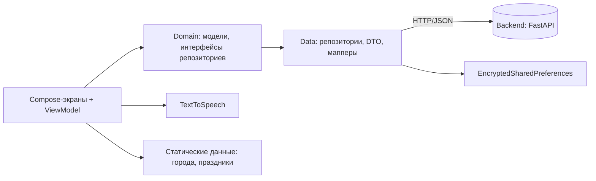

# 白瓷 Chinese Dictionary — Android-клиент

Мобильное приложение для изучения китайского языка русскоговорящими: словарь на базе БКРС, адаптивный HSK-тест, тренажёр с интервальным повторением (SM-2), ИИ-ассистент для практики диалогов и путеводитель по городам Китая.

> **EN:** Android client for a Chinese–Russian dictionary app with an adaptive HSK placement test, spaced-repetition trainer (SM-2), an AI conversation partner with vocabulary control, and offline travel guides. Backend: [Chinese Dictionary backend](https://github.com/<ВАШ_НИК>/<ИМЯ_BACKEND_РЕПО>).

<!-- Добавьте сюда 3–4 скриншота: docs/screenshots/*.png -->
| Главная | Карточка слова | Тренажёр | ИИ-чат |
|:--:|:--:|:--:|:--:|
|  |  |  |  |

---

## Возможности

| Модуль | Что делает |
|---|---|
| **Поиск** | Мультимодальный: по иероглифам, пиньиню и русскому переводу |
| **Карточка слова** | Значения с пометами частей речи, примеры, HSK-уровень, озвучка |
| **Иероглифы** | Анимация написания по чертам (Hanzi Writer), данные Make Me a Hanzi (9 574 знака) |
| **Списки слов** | Свои списки, системный каталог (тематические и HSK-подборки) |
| **Входной тест** | Адаптивный (по принципу CAT): определяет уровень HSK за ~15 минут |
| **Тренажёр** | Карточки с интервальным повторением по алгоритму SM-2 |
| **ИИ-ассистент** | Диалог по выбранному списку слов; лексика ограничена списком + базовым HSK 1–2 |
| **Путеводитель** | 6 городов: Пекин, Шанхай, Сиань, Чэнду, Гуанчжоу, Гонконг; работает офлайн |
| **Календарь** | Китайские праздники 2026–2027 и обратный отсчёт до ближайшего |
| **Рукописный ввод** | Холст с сеткой 米字格 для практики написания |
| **Озвучка** | Нативный Android TextToSpeech (китайская локаль) |

## Стек и архитектура

- **Kotlin 2.0**, **Jetpack Compose** (Material 3), **minSdk 26 / compileSdk 35**, AGP 8.8
- **Clean Architecture + MVVM**: `ui` → `domain` → `data`; состояние экранов — `StateFlow` во ViewModel
- **Koin** — внедрение зависимостей
- **Retrofit + OkHttp + kotlinx.serialization** — сетевой слой; `Interceptor` добавляет идентификатор пользователя
- **Navigation Compose** — навигация
- **EncryptedSharedPreferences** (AES-256-GCM) — локальное хранение сессии



```
app/src/main/java/com/diploma/chinesedictionary/
├── data/        # Retrofit API, DTO, реализации репозиториев, TtsManager, статические данные
├── domain/      # модели и интерфейсы репозиториев
├── di/          # Koin-модули (network, data, viewModel)
└── ui/
    ├── navigation/   # маршруты и граф навигации
    ├── theme/        # палитра «Cobalt-led porcelain»
    └── screens/      # home, search, worddetail, lists, trainer, leveltest, chat, travel, handwriting, profile
```

## Запуск

Нужны: Android Studio (Koala или новее), JDK 17, работающий [backend](https://github.com/<ВАШ_НИК>/<ИМЯ_BACKEND_РЕПО>).

1. Поднимите backend (см. его README) — по умолчанию `http://localhost:8000`.
2. Откройте проект в Android Studio и дождитесь синхронизации Gradle.
3. Проверьте адрес сервера в `BuildConfig.API_BASE_URL`. Для эмулятора локальный сервер доступен по `http://10.0.2.2:8000/`, для реального устройства укажите IP компьютера в локальной сети.
4. Запустите приложение на эмуляторе (проверялось на Pixel 7, API 35) или устройстве.

> Озвучка требует установленного пакета Google Speech Services с китайским языком. Без него кнопки 🔊 молча ничего не делают.

## Дизайн

Авторская палитра **«Cobalt-led porcelain»** (белый фарфор и кобальт): иероглифы — глубокий синий `#0A2540`, приглушённый бордовый `#A42B33` — только для акцентов. Токены цвета вынесены в `ui/theme/Color.kt`.

## Ограничения и план развития

Честно о том, что сделано частично:

- **Уведомления** — реализован интерфейс настроек, фоновая отправка (WorkManager) в планах.
- **Рукописный ввод** — практика на холсте без распознавания.
- **Авторизация** — упрощённая (идентификатор в заголовке); JWT в планах.
- Часть функций (поиск, тренажёр, ИИ-чат) требует сети; офлайн работают путеводитель, календарь, рукописный ввод.

Планы: распознавание рукописного ввода и OCR, голосовой ввод, адаптация ИИ к уровню HSK, WorkManager-напоминания, кэширование для офлайн-режима.

## Связанные репозитории

- **Backend (FastAPI, БД, ETL словаря БКРС):** [Chinese Dictionary backend](https://github.com/<hopemask0/<ИМЯ_BACKEND_РЕПО>)

## Автор

Надежда — [GitHub](https://github.com/hopemask0) · контакты в профиле
